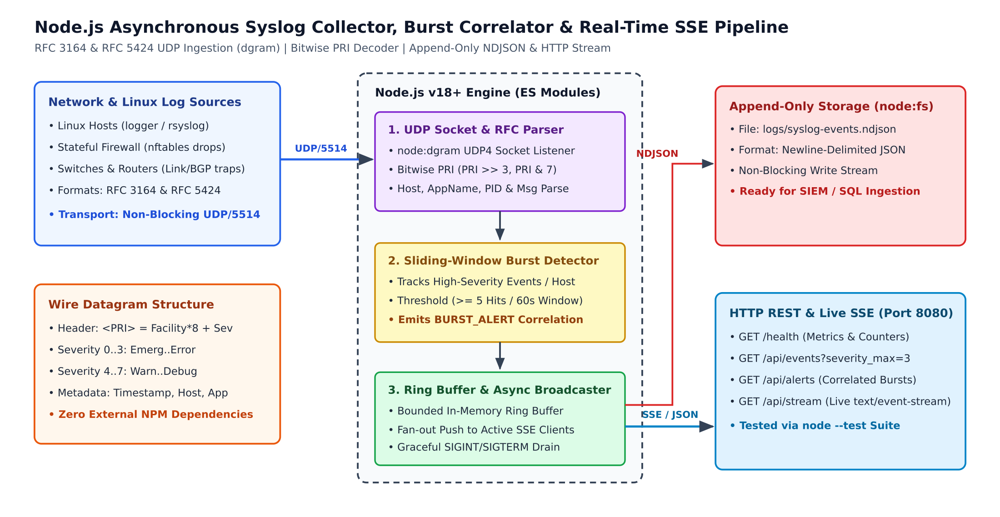

# Node.js RFC 3164/5424 Syslog Collector, Burst Correlator & Live SSE API

A lightweight, **zero-dependency Node.js (`>= 18.18`, ES Modules)** log ingestion server built on native asynchronous I/O (`node:dgram`, `node:http`, `node:fs`). It receives real **UDP Syslog datagrams**, decodes `<PRI>` facility/severity headers, detects high-frequency error bursts per host, persists append-only **NDJSON** archives, and streams live events via **Server-Sent Events (`text/event-stream`)**.

## Pipeline Architecture



## Engineering Capabilities (No Mock Data, Zero NPM Bloat)

1. **Dual-Standard Syslog Wire Parser (`RFC 3164` & `RFC 5424`):** Extracts bitwise `Facility = PRI >> 3` (`0..23`) and `Severity = PRI & 7` (`0=emerg` .. `7=debug`), timestamp, source hostname, application tag, PID, and message body.
2. **Sliding-Window Burst Alert Correlation:** Tracks warning/error/critical events (`severity <= 4`) per source host over a configurable rolling window (default: `>= 5` events within `60s`) to flag SSH brute-force attempts or interface link flaps automatically.
3. **Append-Only NDJSON Persistence & Bounded Ring Buffer:** Streams structured records to `logs/syslog-events.ndjson` for downstream SIEM/SQL analytics while serving low-latency queries from an in-memory circular buffer.
4. **Real-Time HTTP REST & Server-Sent Events (`SSE`):**
   * `GET /health` — Uptime, total UDP packets ingested, severity counters, and active SSE subscribers.
   * `GET /api/events?severity_max=3&host=router-hq&limit=50` — Filtered historical event query.
   * `GET /api/alerts` — Correlated high-frequency burst alerts.
   * `GET /api/stream` — Live `text/event-stream` push feed for NOC terminals and browsers.

## Repository Structure

```text
nodejs-syslog-stream-collector/
├── LICENSE
├── README.md
├── package.json                           # Native ES Module config (zero external dependencies)
├── topology/
│   ├── README.md
│   ├── syslog-pipeline-diagram.png        # Exported pipeline diagram
│   └── syslog-architecture.drawio         # Editable draw.io XML source
├── src/
│   ├── parser.mjs                         # RFC 3164/5424 decoder & sliding-window burst detector
│   └── server.mjs                         # UDP listener, NDJSON writer, HTTP API & SSE streamer
└── tests/
    └── syslog.test.mjs                    # Built-in node:test unit & live UDP/HTTP integration tests
```

## Quick Start & Live Linux Verification

### 1. Run Automated Unit & Integration Tests (`node:test`)

```bash
git clone https://github.com/benjarong-dev/nodejs-syslog-stream-collector.git
cd nodejs-syslog-stream-collector

npm test
```

### 2. Start Collector & Send Real Linux `logger` Packets

**Terminal 1 — Start UDP (`5514`) + HTTP (`8080`) Collector:**
```bash
npm start
```

**Terminal 2 — Transmit Real Syslog Datagrams from Linux & Query API:**
```bash
# Send real RFC 3164 / 5424 datagrams using standard Linux util-linux logger
logger --udp --server 127.0.0.1 --port 5514 --priority local0.crit --tag bgpd "BGP neighbor 10.0.0.1 Down"
logger --udp --server 127.0.0.1 --port 5514 --priority authpriv.err --tag sshd "Failed password for invalid user admin"

# Inspect live health metrics and filtered critical/error events
curl -s http://127.0.0.1:8080/health
curl -s "http://127.0.0.1:8080/api/events?severity_max=3"

# Subscribe to real-time Server-Sent Events stream
curl -N http://127.0.0.1:8080/api/stream
```

## License

MIT License.
